# Home Assistant Configuration

This repository contains my personal configuration for Home Assistant, focused on a clean, room-based dashboard and modular YAML structure.

**Version:** v2.1.0
 - v2 dashboard refactor: modular room and popup cards, light row grid, waste collection
 - v1.1: separation of templates and room cards complete
**Version:** V1.0 (initial public release)
---

## 🖥️ Dashboard Screenshots

### 🏠 Home

| Light Theme | Dark Theme |
|:-------------------------:|:-------------------------:|
| [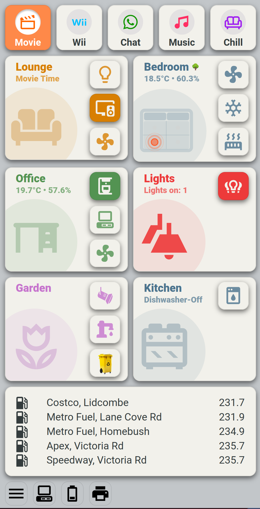](./screenshots/home_light.png) | [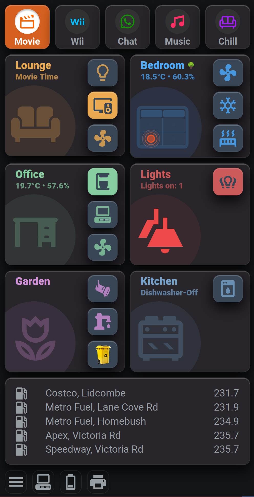](./screenshots/home_dark.png) |

### 🌙 Dark Theme

| | | | |
|:-------------------------:|:-------------------------:|:-------------------------:|:-------------------------:|
| [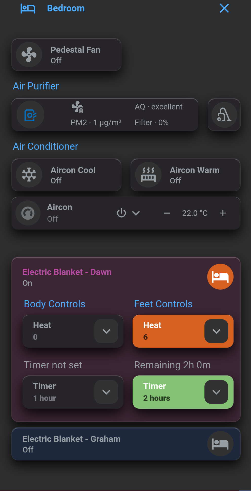](./screenshots/bedroom_dark.png) | [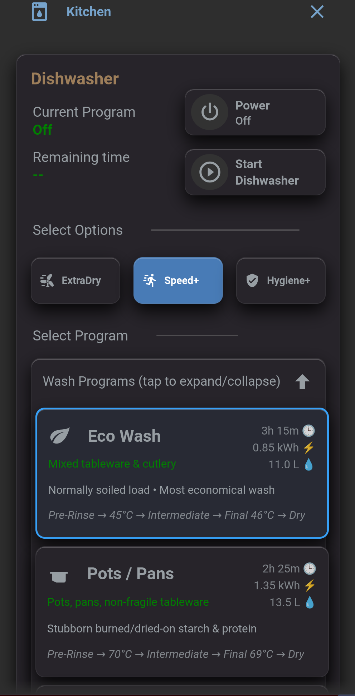](./screenshots/kitchen_dark.png) | [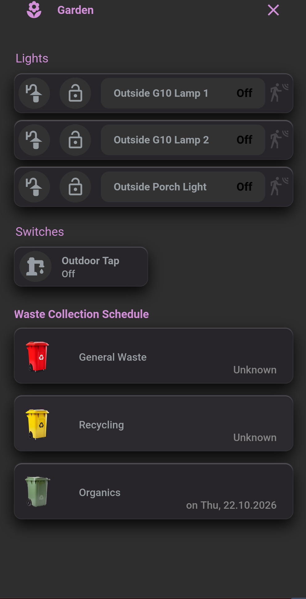](./screenshots/garden_dark.png) | [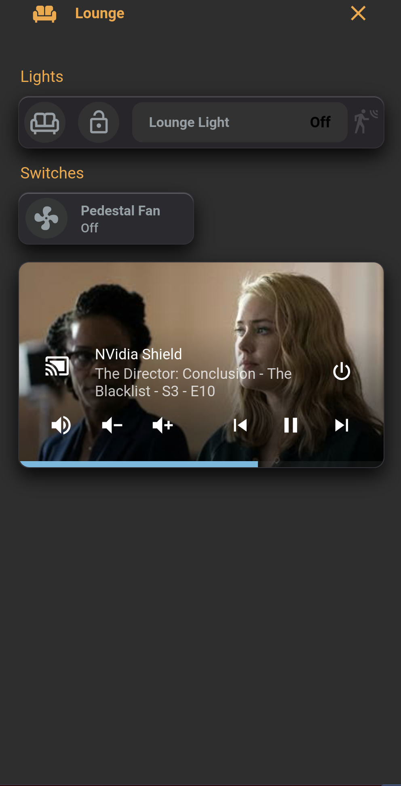](./screenshots/lounge_dark.png) |
| [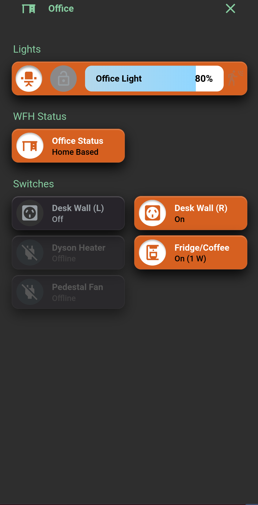](./screenshots/office_dark.png) | [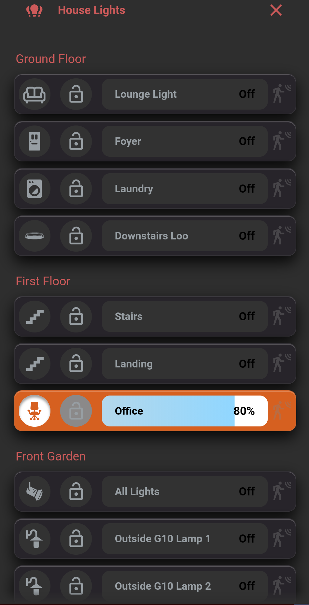](./screenshots/lights_dark.png) | [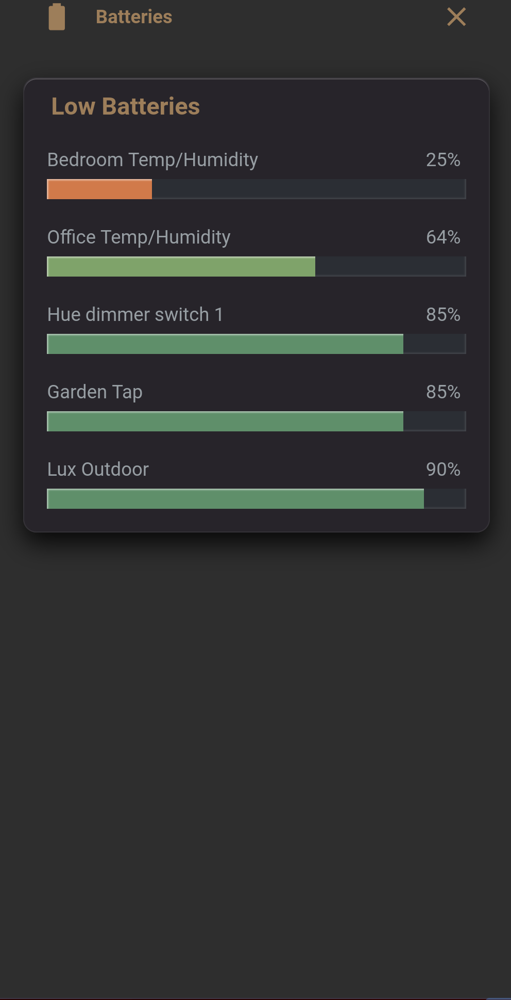](./screenshots/batteries_dark.png) | [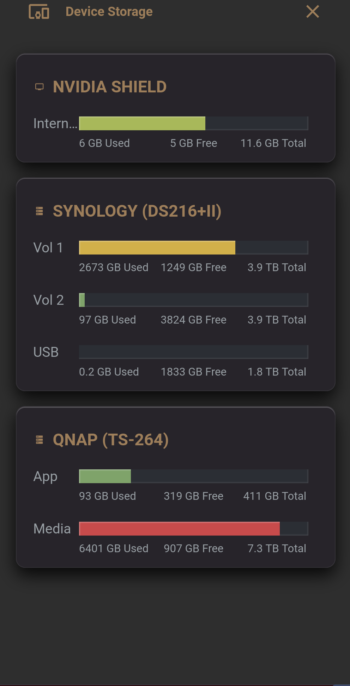](./screenshots/storage_dark.png) |
---
### ☀️ Light Theme

| | | | |
|:-------------------------:|:-------------------------:|:-------------------------:|:-------------------------:|
| [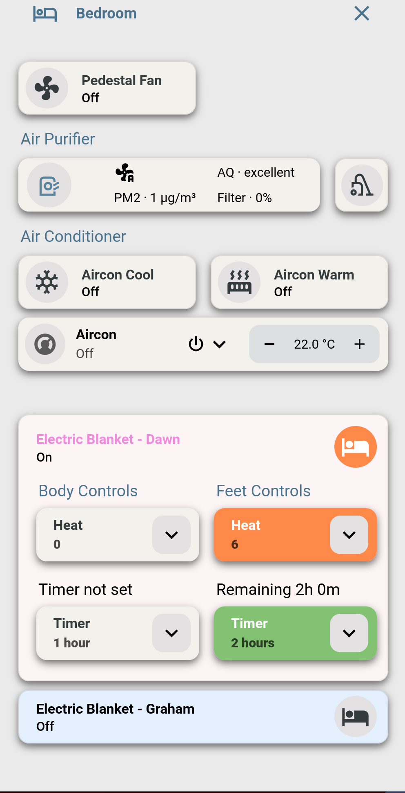](./screenshots/bedroom_light.png) | [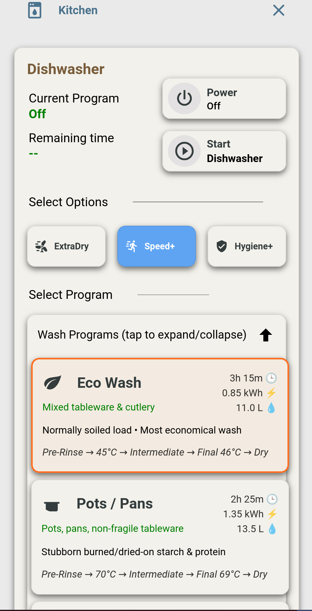](./screenshots/kitchen_light.png) | [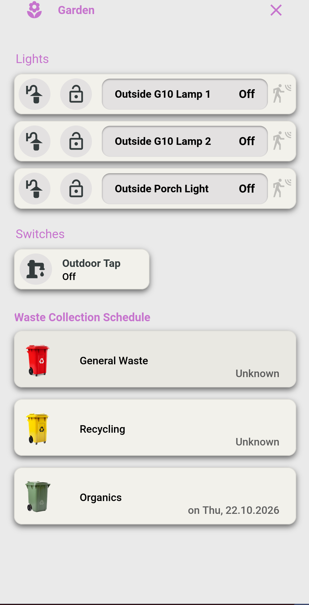](./screenshots/garden_light.png) | [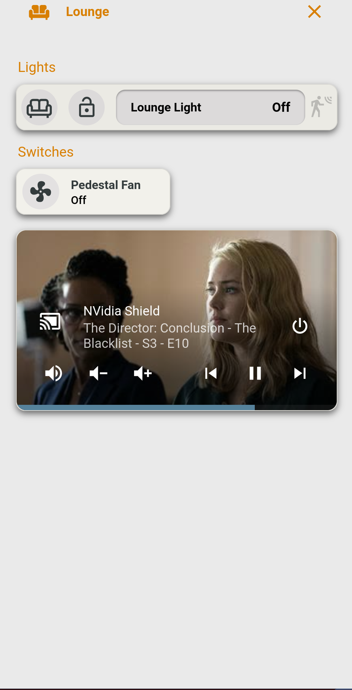](./screenshots/lounge_light.png) |
| [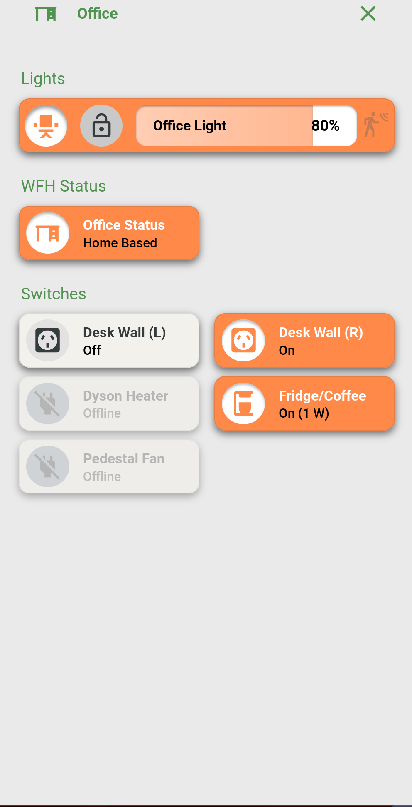](./screenshots/office_light.png) | [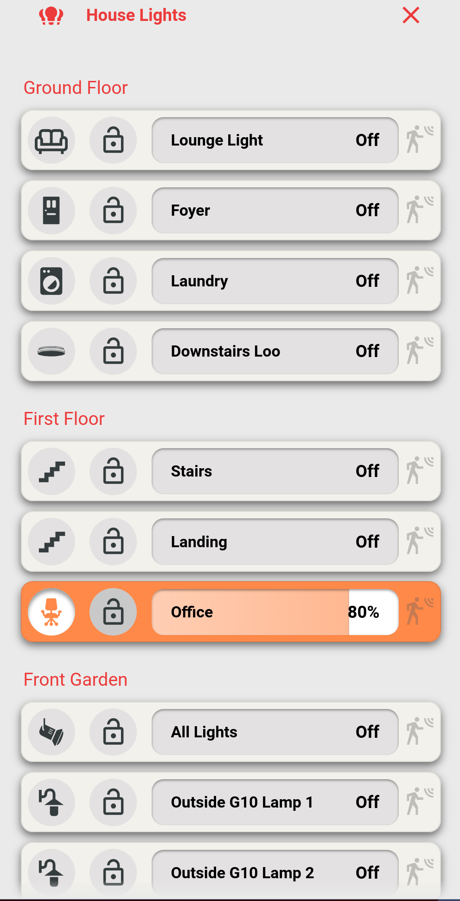](./screenshots/lights_light.png) | [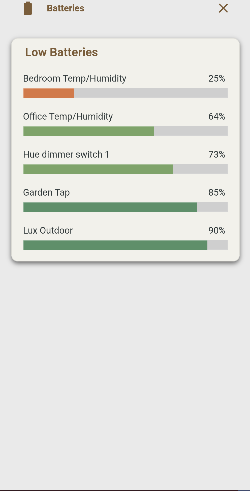](./screenshots/batteries_light.png) | [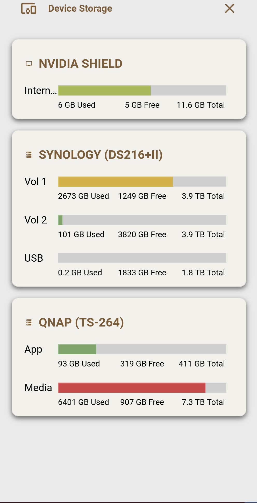](./screenshots/storage_light.png) |


## 🧭 Overview

* **Platform:** Home Assistant
* **Dashboard Mode:** YAML (modular, Git-managed)
* **Design Approach:** Room-centric cards (not multi-page navigation)
* **Automation:** Primarily Node-RED — the JSON flows live in the separate [node-red-flows](https://github.com/littlestotty-labs/node-red-flows) repo (HA YAML automations are minimal)

* **Goal:** Maintainable, version-controlled smart home setup

---

## 🧱 Structure

```text
/config
  /dashboards
    /button_templates
      ** all button-card templates here **
    /home_cards
      banner.yaml
      bedroom.yaml
      garden.yaml
      kitchen.yaml
      lights.yaml
      lounge.yaml
      menu.yaml
      office.yaml
      petrol.yaml
      scenes.yaml
      tech.yaml
      waste.yaml
    /popup_cards
      bedroom.yaml
      garden.yaml
      kitchen.yaml
      lights.yaml
      lounge.yaml
      office.yaml
      petrol.yaml
      tech.yaml
    /includes
      decluttering.yaml
      kiosk.yaml
    ui-lovelace.yaml
  /screenshots
    home_light.png
    bedroom_light.png
    kitchen_light.png
    garden_light.png
    lounge_light.png
    office_light.png
    lights_light.png
    batteries_light.png
    storage_light.png
    home_dark.png
    bedroom_dark.png
    kitchen_dark.png
    garden_dark.png
    lounge_dark.png
    office_dark.png
    lights_dark.png
    batteries_dark.png
    storage_dark.png
  /themes
    dark_theme.yaml
    light_theme.yaml
  configuration.yaml
  customize.yaml
  template.yaml
  automations.yaml
  scripts.yaml
  secrets_example.yaml
  scenes.yaml
  google_calendars.example.yaml
  CHANGELOG.md
  VERSION
```

---

## 🔐 Sensitive Data

Sensitive information is **not included** in this repository.

* `secrets.yaml` is excluded via `.gitignore`
* `google-calendars.yaml` is excluded via `.gitignore`
* Template files are provided:

  * `secrets_example.yaml`
  * `google_calendars.example.yaml`

If you reuse this config, create your own `secrets.yaml`/`google_calendars.yaml` and populate them with your values.

---

## ⚠️ Excluded Files & Folders

The following are intentionally not tracked:

* `.storage/` (Home Assistant internal state)
* `*.db`, logs, backups
* `secrets.yaml`
* `www/` (custom assets such as icons/images)
* `blueprints/` (unused in my instance)
* `custom_*/` (custom components and templates)

* `zigbee2mqtt/`, `esphome/`, and other local integrations

### Notes

* Some UI elements (icons, images) may be missing if they rely on files in `/www/`
* Replace with your own assets or standard MDI icons where needed

---

## 🧩 Custom Cards & Dependencies

This setup uses custom Lovelace cards (via HACS), such as:

* `button-card`
* `card-mod`
* `decluttering-card`
* `bubble-card`
* `Kiosk Mode`


Ensure required resources are installed and available in your Home Assistant instance.

---

## 🚀 Usage

This repository is intended as:

* A personal backup
* A reference for dashboard design and YAML structuring
* A starting point for others building modular Home Assistant dashboards

---

## 📌 Disclaimer

This configuration is tailored to my environment and devices.
It may require modification to work in your setup.

---

## 📷 Screenshots

Screenshots are stored in the `/screenshots` directory and referenced using relative paths.

Each dashboard view is captured in both themes: files suffixed `_light.png` for the light theme and `_dark.png` for the dark theme (e.g. `home_light.png` / `home_dark.png`). The **Dashboard Screenshots** section above shows the `home_*` view as a side-by-side comparison, with the remaining views grouped into per-theme grids — click any thumbnail to view the full-size image.

---

## 🔄 Future Improvements

* Add detail on how my instance is configured (HAOS/Zigbee etc)
* Further modularisation of dashboard components
* Template standardisation for reusable card styles
* Optional Git-based deployment workflow
* Expand kitchen popup card for white-good automation
* and no doubt many more tweaks and updates as my journey evolves.

## 🛠️ Getting Started

---

1. Copy files into your Home Assistant `/config` directory
2. Create `secrets.yaml` based on `secrets_example.yaml`
3. Install required custom cards via HACS
4. Restart Home Assistant

---
